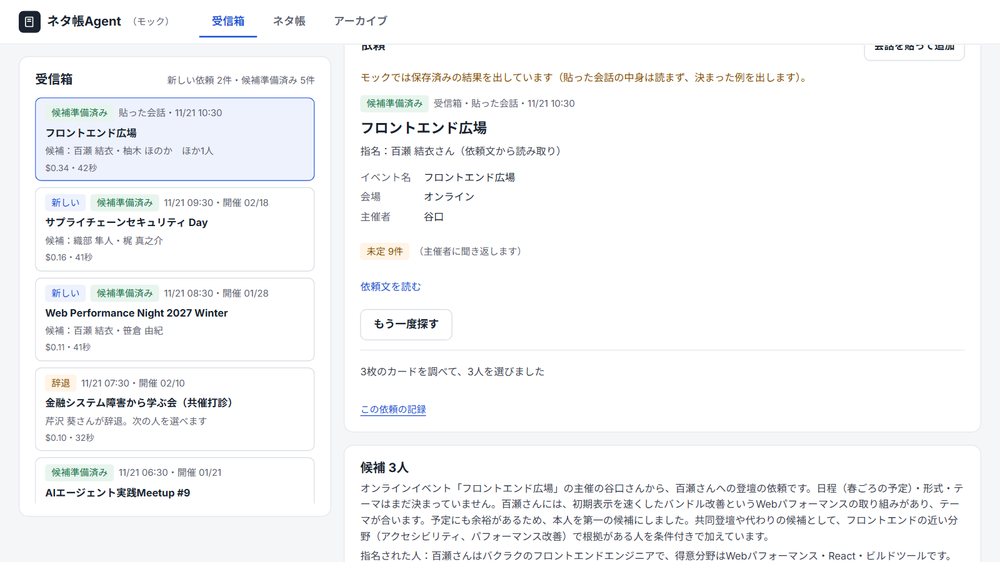
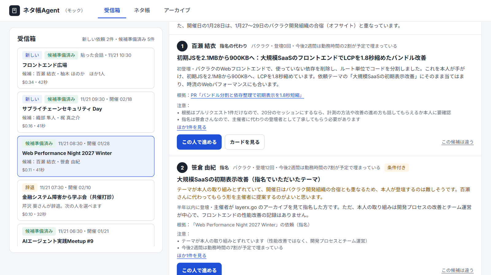
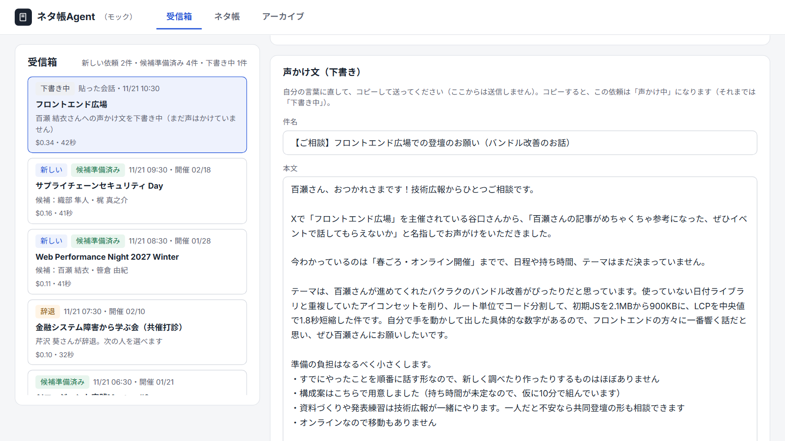
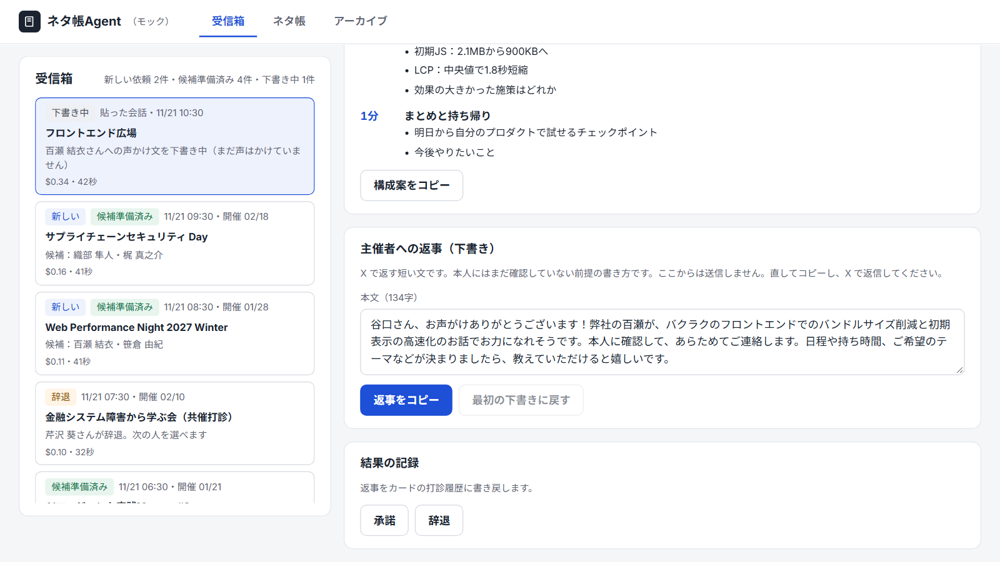
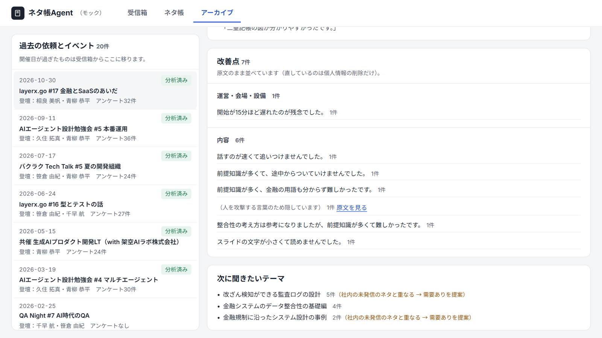
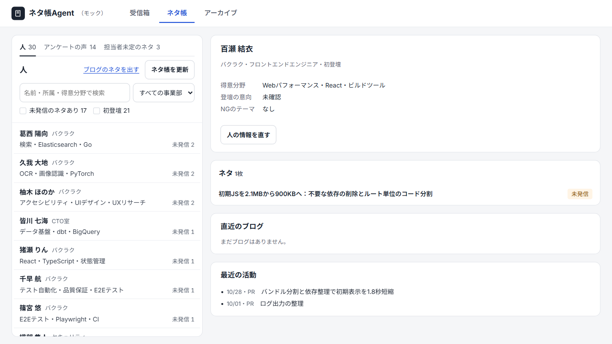
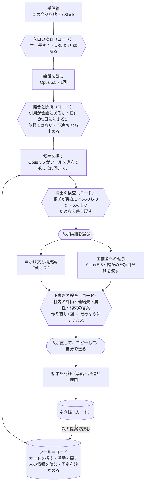
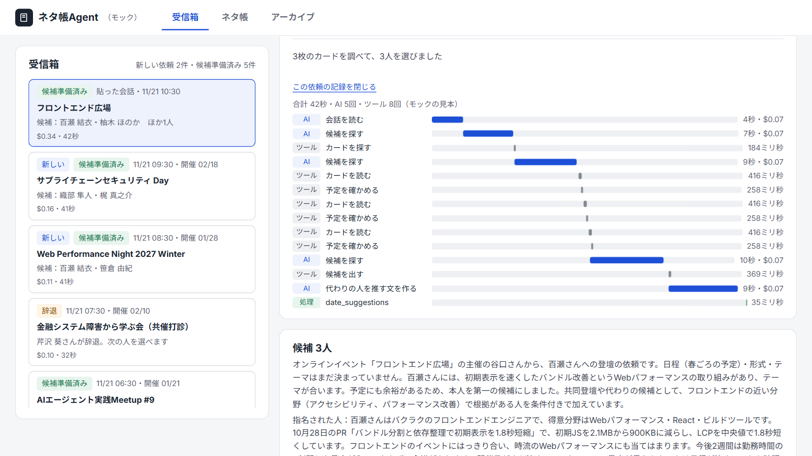
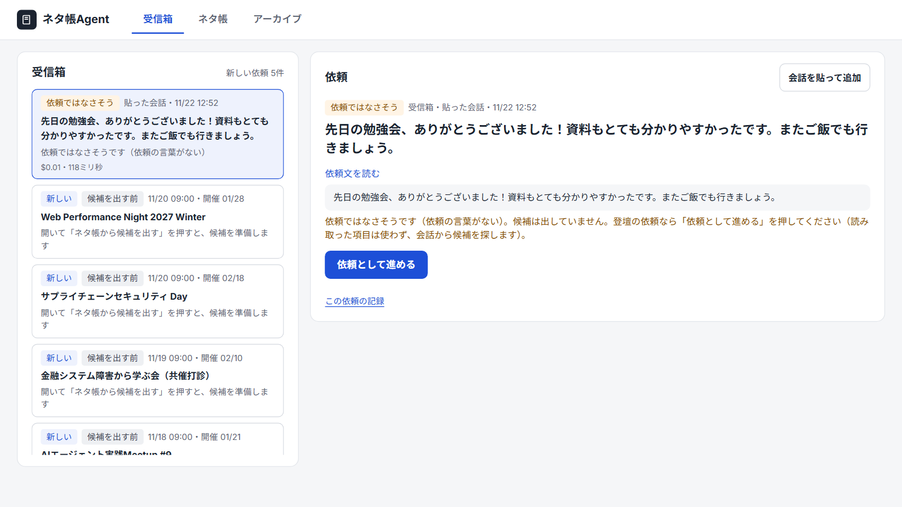

# ネタ帳Agent

**技術広報の「だれに頼むか」を、勘と記憶から、根拠と記録に変える Agent です。**

社外から登壇の依頼が届くと、社内の取り組みをまとめた「ネタ帳」から合う人を探し、理由と根拠をつけて候補を出します。声かけ文と主催者への返事は下書きまで。送るのも、だれに頼むかを決めるのも人です。結果はネタ帳に書き戻され、次の提案に使われます。

LayerX 自律型 AI Agent ハッカソン 2026/11 テーマ3「Tech イベントを一気通貫で支援せよ」の成果物です。データはすべて架空です（例外は [data/README.md](data/README.md) に書いてあります）。

## 解く問題

技術広報へのヒアリングで分かった、登壇者を探すときの困りごとです。

| 困りごと | ネタ帳Agent での解き方 |
| --- | --- |
| 依頼は X の DM やリプライで来る。日程や形式は、やり取りの途中で決まる | 会話をそのまま貼れば、イベント名・日程・人数などを読み取る。読めない項目は「未定」のままにして、主催者に聞き返す文を下書きする |
| 「だれに頼むか」の判断が1人に集中している | 候補に、理由・根拠の投稿・注意点・予定の埋まり具合をつける。頭の中の判断が、画面で読めるものになる |
| 同じ人ばかりに頼んでしまう | まだ社外に出していない取り組みをカードにして先に並べる。登壇の経験や打診の記録も候補と一緒に見える |
| 記録が残らず、引き継げない | 承諾・辞退と理由をカードに書き戻す。次の提案は、その記録を読んで出す |

もとの整理は [docs/spec.md](docs/spec.md) の「1つの仕組みで解く問題」にあります。

## 使う流れ

1. **受信箱に依頼が届く**：X の会話を貼るか、Slack の依頼チャンネルに投稿する。届いた時点で、Agent が裏で候補を準備する（20〜30秒ほど）。ほかの画面にいても、終わると知らせが出る
2. **候補を読む**：読み取った項目、候補（5人まで。合う人がいなければ無理に埋めない）、選んだ理由、根拠の投稿、注意点、予定の埋まり具合。日程が未定なら、空いていそうな日も出す
3. **この人で進める**：声かけ文・発表の構成案・主催者への返事の下書きができる。直してコピーして、自分で送る
4. **結果を記録する**：承諾・辞退と理由を押すと、その人のカードに書き戻される
5. **開催後**：アンケートの回答（CSV）を取り込むと、良かった点・改善点・次に聞きたいテーマにまとめる
6. **ネタ帳に戻る**：反応と「次に聞きたいテーマ」がカードに入り、次の依頼で使われる

画面はこうなります（`?mock` で撮ったもの。データは架空です）。10枚すべての一覧は [docs/screenshots/README.md](docs/screenshots/README.md) にあります。

**1. 受信箱に X の会話を貼ると、項目を読み取る**（読めない項目は「未定」にたたむ）



**2. 候補を読む**（初登壇の印・理由・注意点・予定の埋まり具合・根拠のリンク）



**3. 声かけ文と、主催者への返事の下書き**（返事は、未定の項目を聞き返す）





**5. 開催後のアンケート**（改善点は原文のまま。次に聞きたいテーマも出す）



**6. ネタ帳に戻る**（人ごとのネタと、アンケートの「次に聞きたい話」）



## 考え方

- **最後に決めるのは人**：Agent は候補と下書きを出すところまで。送信の手段を持たせていません。だれに頼むか、何を送るかは技術広報が決めます
- **分からないことは、分からないと言う**：会話に書かれていない日程や人数は「未定」のまま。合う人がいなければ「見つからない」と理由を返します。数をそろえるために、根拠の弱い人を足しません
- **機会を偏らせない**：性別・年齢・国籍などの属性では絞りません（社員データに持たず、推測もしません）。まだ発信していない人の取り組みが、先に見えるようにしています
- **使うほど育つ**：承諾・辞退の理由、アンケートの反応、「この候補は違う」の記録が、ネタ帳と評価のケースに戻ります

役割の分け方は1つです。

> **AI は、読む・判断する・書く。数える・決める・止めるは、コード。**

日付が1日に決まっているか、根拠の投稿が実在するか、返事に社内の事情が混ざっていないか、API 代が上限を超えていないか。こうした境界は、指示文でお願いするのではなく、Agent の外のコードで守ります。AI が間違えても、外に出る前に止まります。

## 作り



- **モデルとツールの分け方**：モデルが決めるのは「何を調べるか」と「だれが、どのテーマで合うか」。検索・予定の重なり・件数・日付の計算は、ツール（コード）が返した結果を使います
- **Opus 5.5 と Fable 5.2 の使い分け**：回数の多い仕事（会話を読む・候補を探す・主催者への返事・アンケート）は Opus 5.5。そのまま人に送る文になる声かけ文と、指名された人の代わりを推す文だけ Fable 5.2。Fable が使えなければ Opus で作り直します。累計の金額が決めた額を超えると、1段軽いモデルに自動で切り替わります
- **コードの検査の位置**：図の六角形の4か所。AI の呼び出しの前に1つ、後ろに3つあります
- **画面で確かめられる**：依頼ごとの「この依頼の記録」に、AI とツールを呼んだ順番・時間・金額が出ます



くわしい仕様は [docs/spec.md](docs/spec.md)、保存の入口は [docs/storage.md](docs/storage.md) にあります。

## 安全とプライバシー

- **送信の手段を持たない**：メールも DM も送れません。下書きの表示とコピーだけです
- **Slack は決まった文だけ**：ボットが書くのは、依頼スレッドへの「受け付けました」と、技術広報だけの非公開チャンネルへの「準備できました」の2つ。候補の名前・理由・件数は Slack のどこにも書きません
- **確かめた項目だけを渡す**：主催者への返事を作る AI には、会話の原文を渡しません。コードで確かめた項目（イベント名・日程・人数など）と、進める人の名前とテーマだけです。会話に指示が仕込まれていても、返事には届きません（確かめた結果は [docs/injection_check.md](docs/injection_check.md)）
- **関所**：依頼ではない文（雑談・営業）と不適切な文（暴言・個人情報を求めるもの）は、候補づくりを始めずに止めます。不適切な文の原文は、一覧に出しません（入力の試験は [docs/edge_cases.md](docs/edge_cases.md)、いじわるな使い方の試験は [docs/abuse_test.md](docs/abuse_test.md)）

  

- **個人情報を保存しない**：アンケートの名前・メールの列は、取り込むときに捨てます。カジュアル面談の希望は、人数と行番号だけを残します。カレンダーから読むのは開始・終了・終日かどうかだけで、予定の名前や場所は読みません
- **見せる用の守り**：会場の人に触ってもらうときは、発表用とは別のサーバー・別のデータの置き場で立てます。合言葉、API 代の上限（全体と1人あたり）、同時に動かす数の上限があり、ネタ帳の更新は止めます

## 品質

**テストは4つの層**です。どれも本物の API を使いません（[docs/testing.md](docs/testing.md)）。

| 層 | 守るもの |
| --- | --- |
| 1. ユニット | 関数ひとつひとつの決まり（日付の読み方・関所・候補の検証・金額の計算など） |
| 2. API | 窓口の約束。本物のサーバーを立て、偽の AI につないで要求を投げる |
| 3. E2E | 画面でデモの流れが通ること（貼る → 候補 → 下書き → 承諾 → アーカイブ → ネタ帳） |
| 4. 評価 | 保存してある Agent の結果が、守るべき決まりを満たすこと |

**評価は2本立て**です（[docs/evals.md](docs/evals.md)）。

- **保つ評価**：壊してはいけないもの。90% を切ったら main に入れません。今は 100%（47件）
- **上げる評価**：弱いところ・本番で失敗したところを集めたもの。点数は低くてよく、main より下がっていないかを見ます。直って毎回通るようになったケースは、保つ評価に移します。今残っているのは2件です

**本番で見つけて、直した3つ**（同じ入力を本物の API で5回ずつ流した結果）

| 見つけたこと | 直す前 | 直したあと | 直し方 |
| --- | --- | --- | --- |
| あとから日程が決まる会話で、日程を読めない（N2） | 1/5 | 5/5 | 会話の最後の「決まりました」の一節から、コードが日付を決める |
| 複数の依頼が混ざった文で、1件目の日程が未定になる（F3） | 0/5 | 5/5 | 1件目の依頼の範囲の中だけで、日付を決める |
| 指名の依頼で、テーマ案にほかの社員の名前が入る（req004） | 2/5 | 5/5 | 候補づくりの指示文に決まりを足した |

3つとも、いまは保つ評価に入っています。

発表と質問の答えに使う数字（評価・テスト・費用・安全。出どころと日時つき）は [docs/numbers.md](docs/numbers.md) にまとめました。

## 費用

実測と試算は [docs/cost_estimate.md](docs/cost_estimate.md) にあります（どれも米ドル）。

- **依頼1件**：社員100人の会社で 約 $0.25、300人で 約 $0.34（会話を読む・候補を探す・代わりの人を推す文・声かけの下書きの合計）。今のデモのデータでの実測は、候補を探すのに $0.095、声かけの下書きに $0.088（どちらも中央値）
- **月の合計**（依頼 月10〜30件、アンケート 月2〜4回、ネタ帳の更新 週1回）：100人で 約 $22〜41、300人で 約 $62〜111
- 金額の9割はネタ帳の更新です。毎日更新すると、300人では月 $200 の上限を超えるので、週1回にしています
- 画面には、依頼ごとの金額と時間が出ます

## 動かし方

Node.js が要ります。設定は `.env` に書きます（項目の名前は [.env.example](.env.example)。値はどこにも書かず、コミットもしません）。

```bash
npm install
```

```bash
npm run build
```

| やりたいこと | 命令 | 開く場所 |
| --- | --- | --- |
| 発表用（この端末だけ） | `npm start` | http://127.0.0.1:3000 |
| 見せる用（同じネットワークの人に触ってもらう） | `npm run start:share` | 起動したときに出る URL（3100番） |
| API を使わずに画面を見る | `npm start` のあと | http://127.0.0.1:3000/?mock |
| 開発しながら動かす | `npm run dev` | http://127.0.0.1:3000 |
| テスト（API なし） | `npm test` | — |
| 画面を通すテストも流す | `npm run test:all` | — |

`.env` の主な項目（名前だけ）

- 必ず要るもの：`ANTHROPIC_API_KEY`
- モデルと金額：`AGENT_MODEL`、`HEAVY_MODEL`、`USAGE_SWITCH_USD`
- 見せる用：`ACCESS_CODE`、`SHARE_BUDGET_USD`、`SHARE_PER_PERSON_USD`
- Slack ボット（練習用のワークスペースだけ）：`SLACK_BOT_TOKEN`、`SLACK_APP_TOKEN`、`SLACK_REQUEST_CHANNEL`、`SLACK_NOTIFY_CHANNEL`、`SLACK_ALLOWED_TEAM_ID`
- デモ用の本人と予定：`DEMO_PERSON`、`CALENDAR_ICS_URL`

`?mock` は保存してある結果だけで動くので、`.env` がなくても画面を見られます。Slack ボットの設定、見せる用の立て方、アンケート、初期状態への戻し方などの細かい手順は [docs/setup.md](docs/setup.md) にまとめました。

## 今後

今の作りは「1人の技術広報が、1台の端末で使う」前提です。社員数百人・複数の会社で使えるようにするための作業（保存の入口を1つにする、DB への移行、会社ごとの分離、利用者と権限など）と、その順番は [docs/roadmap.md](docs/roadmap.md) にあります。

## ライセンス

[MIT](LICENSE)
